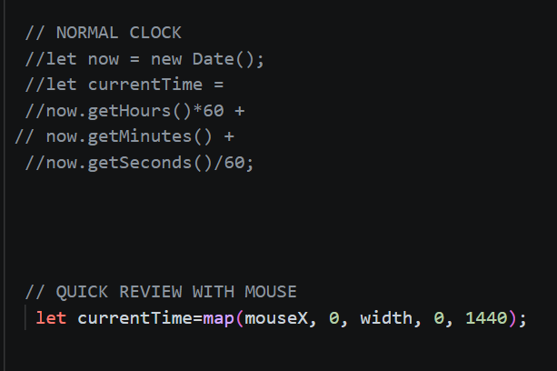
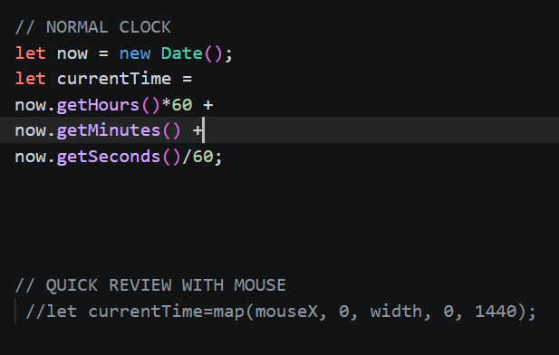
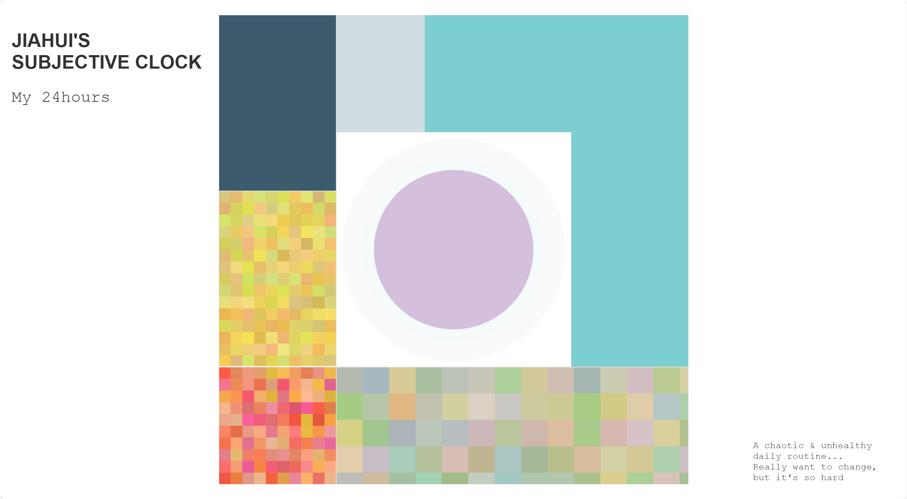

# Week 6

**Date:** Oct 8

## Topic
Functions and Arrays

## Content
advanced arrays

## Assignment
Assignment 6: Looping animations (Due Oct 15)

## Introductions
This is a totally my personal clock
There are two diffenrent modes. You can quickly review all the effects moving the mouse horizontally.

Or you can switch to the normal mode, seeing the real-time effect.

The complete effect

# Week 6

**Date:** Oct 8

## Topic
Animating Sprites

## Content
functions

## Assignment
Assignment 6: Animated Clock (Due Oct 15)
